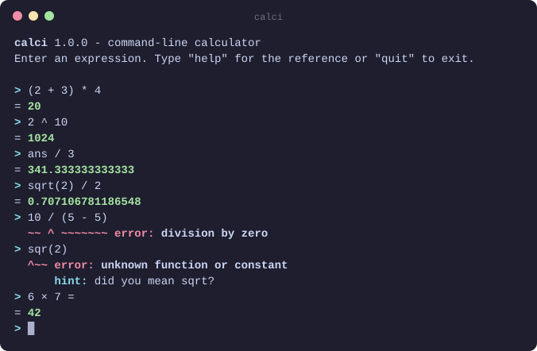

# Calculator

<p align="center">
  
</p>

`calci` is a command-line calculator written in portable C99. Type an
expression and get the answer, with the conveniences of a modern shell:
colors, history, Tab completion, and error messages that point at the
mistake and suggest how to fix it.

```console
$ calci "(2 + 3) * 4"
20
$ calci "sqr(2)"
calci: error: unknown function or constant
    sqr(2)
    ^~~
    hint: did you mean sqrt?
```

- **Real arithmetic.** Precedence, parentheses, powers, 17 functions, `pi`,
  `e`, and `ans` for the previous result, in double precision.
- **Helpful errors.** The problem is underlined, often with a hint, and bad
  input can never crash calci: division by zero, overflow and nonsense are
  all reported as errors.
- **A pleasant prompt.** Arrow keys, history, Tab completion and the usual
  Ctrl shortcuts; colors on terminals, plain text everywhere else.
- **Script-friendly.** Evaluate one expression, or a whole file line by line,
  with meaningful exit statuses.
- **No dependencies.** A C99 compiler is all it takes, on Linux, macOS or
  Windows.

## Building

```sh
make            # builds ./calci
make test       # runs all the tests
make install    # optional: copies calci to /usr/local/bin (set PREFIX to change)
```

Without `make`, compile the four source files directly:

```sh
cc -std=c99 -O2 -o calci src/*.c -lm                   # Linux, macOS, MinGW
cl /O2 /Fecalci.exe src\*.c                            # Visual Studio prompt
```

## Usage

### Interactive

Run `calci` on its own to start a session:

```console
$ calci
calci 1.0.0 - command-line calculator
Enter an expression. Type "help" for the reference or "quit" to exit.

> 2 ^ 10
= 1024
> ans / 4
= 256
> 10 / (5 - 5)
  ~~ ^ ~~~~~~~ error: division by zero
> quit
```

| Key                     | Does                                                  |
| ----------------------- | ----------------------------------------------------- |
| Left, Right, Home, End  | move the cursor (also Ctrl+B, Ctrl+F, Ctrl+A, Ctrl+E) |
| Ctrl+Left, Ctrl+Right   | move by a word (also Alt+B, Alt+F)                    |
| Up, Down                | recall earlier lines (also Ctrl+P, Ctrl+N)            |
| Tab                     | complete a name: `sq` becomes `sqrt(`                 |
| Ctrl+K, Ctrl+U, Ctrl+W  | delete to the end, to the start, the word before      |
| Ctrl+L                  | clear the screen, as does the `clear` command         |
| Ctrl+C                  | abandon the line                                      |
| Ctrl+D                  | quit, as do `quit` and `exit`                         |

`help` shows the reference below. In the Windows console, the console's own
line editing applies instead: arrows and Up/Down history work, and Ctrl+Z
then Enter quits.

### A single expression

```console
$ calci "2 ^ 0.5"
1.4142135623731
$ calci 2 + 3
5
```

Quote the expression: unquoted, the shell treats characters such as `*`, `(`
and `)` specially.

### A file or pipe of expressions

When standard input is not a terminal, calci evaluates it line by line and
prints one result per line. Blank lines are skipped, and an error does not
stop the lines after it.

```console
$ printf '1 + 1\n1 / 0\n3\n' | calci
2
calci: line 2: error: division by zero
    1 / 0
    ~ ^ ~
3
```

Output that goes to a file or a pipe is plain text, without colors or `= `
prefixes, and results go to standard output while everything else goes to
standard error. Colors can also be turned off by setting the `NO_COLOR`
environment variable.

The exit status is 0 if everything was evaluated, 1 if an expression failed,
and 2 for an unknown option. (In an interactive session a typo is not a
failure, so the status stays 0.)

## Reference

| Operator    | Meaning                         | Example                  |
| ----------- | ------------------------------- | ------------------------ |
| `( )`       | grouping                        | `(2 + 3) * 4` is 20      |
| `^`         | power, right-associative        | `2 ^ 3 ^ 2` is 512       |
| `+` `-`     | sign                            | `-2 ^ 2` is -4           |
| `*` `/` `%` | multiply, divide, remainder     | `7 % 3` is 1             |
| `+` `-`     | add, subtract                   | `10 - 4 - 3` is 3        |

Operators are listed from highest to lowest precedence; those on the same row
are evaluated from left to right, except `^`.

- **Numbers:** `42`, `3.14`, `.5`, `6.022e23`
- **Constants:** `pi`, `e`, and `ans`, the previous result (0 at first)
- **Functions:** `abs`, `sqrt`, `cbrt`, `exp`, `ln` (natural logarithm),
  `log` or `log10` (base 10), `log2`, `sin`, `cos`, `tan`, `asin`, `acos`,
  `atan`, `floor`, `ceil`, `round`

A few details:

- Angles are in radians: `sin(30 * pi / 180)` is 0.5.
- `%` is the remainder of a division that truncates toward zero, as in C, so
  it has the sign of the dividend: `-7 % 3` is -1.
- There is no implicit multiplication: write `2 * pi`, not `2pi`.
- Names are case-insensitive: `PI` and `Sqrt(2)` work too.
- `round` rounds halves away from zero: `round(-2.5)` is -3.
- As on a pocket calculator, an expression may end with `=`: `2 + 2 =`.
- The typographic symbols × ÷ − π, as pasted from documents, work like
  `*` `/` `-` `pi`.

Results are computed in double precision and shown with up to 15 significant
digits, so `0.1 + 0.2` shows as `0.3`. Whole numbers are shown in full up to
2^53 = 9007199254740992, the range in which a double holds every integer
exactly; beyond it they are rounded too: `2 ^ 64` shows as
`1.84467440737096e+19`.

## Errors

calci stops at the first problem and marks it: `^` under the offending
token, and `~` under the rest of what is involved, such as both operands of
a division by zero. Syntax errors are reported in preference to math errors,
so `1 / 0 )` complains about the `)`.

| Message                            | Examples                                  |
| ---------------------------------- | ----------------------------------------- |
| `division by zero`                 | `1 / 0`, `5 % 0`, `0 ^ -1`                |
| `result is not a real number`      | `sqrt(-1)`, `ln(-2)`, `(-8) ^ (1/3)`      |
| `result is out of range`           | `10 ^ 400`, `exp(1000)`, `ln(0)`          |
| `expected a number`                | `2 +`, `* 3`, `()`                        |
| `expected an operator`             | `2 3`, `2 (3)`                            |
| `expected ')'`                     | `(2 + 3`                                  |
| `unmatched ')'`                    | `2 + 3)`                                  |
| `expected '(' after function name` | `sqrt 4`                                  |
| `unknown function or constant`     | `x + 1`, `foo(2)`                         |
| `invalid number`                   | `1.2.3`, `0x1F`, `2pi`                    |
| `invalid character`                | `2 $ 3`, `2,5`                            |
| `expression is nested too deeply`  | more than 256 levels of `(`, signs or `^` |

Where a likely fix exists, a hint follows the error: `did you mean sqrt?`
for `sqr(2)`, `use * to multiply: 2 * pi` for `2pi`, `write sqrt(4)` for
`sqrt 4`, `use . as the decimal point` for `2,5`, or `for real cube roots,
use cbrt(x)` for `(-8) ^ (1/3)`.

## Development

`make test` runs three suites: unit tests of the evaluator, end-to-end tests
of the command, and tests of interactive sessions that type into calci in a
pseudo-terminal and check the screen (these need Python 3 and a POSIX
system). CI runs them on Linux with GCC and Clang, on macOS, with
AddressSanitizer and UBSan, and with MSVC on Windows, treating warnings as
errors.

| Path                           | Contents                                              |
| ------------------------------ | ----------------------------------------------------- |
| `src/calc.h`, `src/calc.c`     | the evaluator: a recursive-descent parser with no I/O |
| `src/main.c`                   | the `calci` command: arguments, sessions, messages    |
| `src/editor.h`, `src/editor.c` | the line editor: keys, history, completion            |
| `src/term.h`, `src/term.c`     | terminal detection, colors, Windows console setup     |
| `tests/test_calc.c`            | unit tests for the evaluator                          |
| `tests/cli.sh`                 | end-to-end tests for the command                      |
| `tests/interactive.py`         | tests of interactive sessions in a pseudo-terminal    |

The evaluator can be reused on its own: `calc_evaluate("2 + 2", 0.0)` returns
the value, or the kind of error and where it is in the string. See
[`src/calc.h`](src/calc.h).
